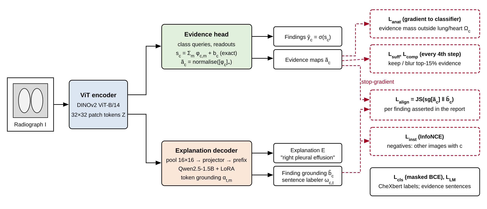

# 3. Method

An image passes through a vision transformer whose patch tokens feed two branches: an evidence head that produces finding logits with their exact per-patch decomposition, and an explanation decoder that reads pooled visual tokens and writes findings text (Figure 1). Training couples the branches through the evidence of each finding. Inference returns a label vector, an evidence map per finding and a grounded explanation.

{width=6.6in}

## 3.1 Setting and notation

Each training example is a radiograph $I$, a label vector $y\in\{0,1\}^C$ over $C$ findings with a mask $\mu\in\{0,1\}^C$ marking which labels are annotated, and a report $R$. The task is to output finding probabilities $\hat{y}$, an evidence map per finding, and an explanation $E$ whose statements about findings are grounded in the evidence the probabilities depend on (Table 1).

| Symbol | Meaning | Shape |
|---|---|---|
| $Z=[z_1,\dots,z_M]$ | patch tokens from the encoder $f_\theta$ | $M\times D$, $M=g^2$ |
| $s_c$ | logit of finding $c$ | scalar |
| $\phi_{c,m}$ | contribution of patch $m$ to $s_c$ | $C\times M$ |
| $\tilde a_c$ | evidence distribution of finding $c$ | simplex over $M$ (or $P$ after pooling) |
| $V$ | visual tokens read by the decoder | $P\times D$, $P=p^2$ |
| $\alpha_{t,m}$ | grounding of target token $t$ on visual token $m$ | $T\times P$ |
| $\omega_{c,t}$ | indicator that token $t$ lies in a sentence asserting $c$ | $C\times T$ |
| $\tilde b_c$ | text grounding of finding $c$ | simplex over $P$ |
| $\Omega_c$ | anatomically plausible region of finding $c$ | binary over $M$ |

Table: **Table 1.** Notation.

## 3.2 Evidence head with an exact patch decomposition

For each finding $c$ and attention head $h\in\{1,\dots,H\}$ the head holds a query $q^h_c$ and a readout vector $w^h_c$ and computes

$$\beta^h_{c,m}=\operatorname{softmax}_m\!\left(\frac{q^{h\top}_c W^h_K z_m}{\sqrt d}\right),\qquad s_c=\sum_{h=1}^{H}\sum_{m=1}^{M}\beta^h_{c,m}\,w^{h\top}_c W^h_V z_m + b_c .$$

With $\phi_{c,m}=\sum_h \beta^h_{c,m}\,w^{h\top}_c W^h_V z_m$, the logit is $s_c=\sum_m \phi_{c,m}+b_c$ exactly. This is the class-attention analogue of the identity that makes CAM exact for a linear head on average-pooled features [@zhou2016cam]: completeness holds by construction, and a positive $\phi_{c,m}$ is evidence for $c$ while a negative one is counter-evidence. The decomposition is exact for the head, not for the encoder, and the tokens are contextualised by self-attention, so $\phi_{c,m}$ attributes the head's output to positions that carry information from elsewhere. CAM-style maps share both caveats, which is why Section 4.4 tests causal dependence directly.

The evidence distribution keeps positive evidence and normalises it,

$$\tilde a_{c,m}=(1-\epsilon)\frac{[\phi_{c,m}]_+}{\sum_{m'}[\phi_{c,m'}]_+}+\frac{\epsilon}{M},\qquad \epsilon=10^{-3}.$$

Normalising by the positive mass makes the distribution invariant to the scale of $\phi$, which a softmax would not (Supplementary Note 2), and the $\epsilon$-floor keeps divergences finite. Classification uses a masked binary cross-entropy with positive-class weights $\pi_c$ capped at 10:

$$\mathcal{L}_{\mathrm{cls}}=-\frac{1}{\sum_c\mu_c}\sum_c \mu_c\left[\pi_c\,y_c\log\sigma(s_c)+(1-y_c)\log(1-\sigma(s_c))\right].$$

## 3.3 Explanation decoder and token grounding

The decoder follows the LLaVA design [@liu2023llava]. The $32\times32$ encoder tokens are average-pooled to $P=16\times16$ visual tokens, mapped by a two-layer projector into the embedding space of a causal language model, and placed before the prompt "Findings:" as a soft prefix. The language model, Qwen2.5-1.5B-Instruct [@qwen2025], is adapted with LoRA [@hu2022lora] on its attention projections, and the projector is trained in full. The visual tokens enter the decoder through a stop-gradient, so no decoder loss reaches the encoder: the classifier is trained by $\mathcal{L}_{\mathrm{cls}}$, $\mathcal{L}_{\mathrm{anat}}$ and $\mathcal{L}_{\mathrm{suff}}+\mathcal{L}_{\mathrm{comp}}$ alone and the explanation is trained to follow it. In the synthetic study, letting decoder losses update the shared encoder cost 2.4 AUROC points (Section 5.1).

Because the visual tokens form a prefix, the grounding of a target token is read from the self-attention block that connects text positions to prefix positions. If $\tau(t)$ is the position whose output predicts token $t$,

$$\alpha_{t,m}=\frac{\bar A_{\tau(t),m}}{\sum_{m'=1}^{P}\bar A_{\tau(t),m'}},\qquad \bar A=\frac{1}{|\mathcal{K}|H'}\sum_{k\in\mathcal{K}}\sum_{h=1}^{H'}A^{(k,h)},$$

with $\mathcal{K}$ the last four layers and $A^{(k,h)}$ the attention matrix of head $h$ in layer $k$. Renormalising over visual tokens removes the mass given to text positions, so $\alpha_{t,\cdot}$ shows where the attention paid to the image went. A lighter decoder with explicit cross-attention (GPT-2 with added cross-attention layers) provides $\alpha_{t,m}$ directly and tests whether conclusions depend on the decoder family. Attention is used because it is defined for every token at no extra cost and is differentiable. It is not assumed to describe the decoder's computation faithfully [@jain2019; @wiegreffe2019]; the alignment uses it as the place the decoder is told to look, and Section 4.4 tests whether the output depends on that place.

## 3.4 Which tokens talk about which finding

A rule-based labeler with NegEx-style negation and uncertainty scopes splits each report into sentences and identifies the findings each sentence asserts positively. Let $\omega_{c,t}=1$ if token $t$ lies in a sentence that positively asserts $c$; tokenizer character offsets map sentences to tokens. The text grounding of finding $c$ is the token-averaged grounding of those tokens,

$$\tilde b_c=\frac{\sum_t \omega_{c,t}\,\alpha_{t,\cdot}}{\sum_t\omega_{c,t}},$$

followed by the same $\epsilon$-floor as $\tilde a_c$. The pair $(\tilde a_c,\tilde b_c)$ enters the alignment loss only when $c$ is labelled positive and annotated and at least one sentence asserts it, so a negated mention ("no pneumothorax") never receives a location. Token relevance cannot come from gradients of the classifier score with respect to the text, because the classifier depends on the image alone and that gradient is zero. Training labels come from CheXbert applied to the reports [@smit2020]. The rule labeler is used for sentence-to-finding assignment and for the four findings CheXbert does not cover, and its agreement with CheXbert is a quality check (Supplementary Table S1).

The explanation target is the subset of report sentences that assert at least one finding, or a normal statement when none does, following the construction of MIMIC-NLE [@kayser2022]; this keeps the text about evidence and not about comparisons, devices or recommendations. The language-modelling loss $\mathcal{L}_{\mathrm{LM}}$ is the token-level cross-entropy on this target.

## 3.5 Evidence alignment

The evidence distribution is pooled to the decoder grid by summing each $2\times2$ block, which preserves normalisation. The alignment loss averages a Jensen–Shannon divergence [@lin1991] over the valid set $\mathcal{V}$ of (image, finding) pairs:

$$\mathcal{L}_{\mathrm{align}}=\frac{1}{|\mathcal{V}|}\sum_{(i,c)\in\mathcal{V}}\mathrm{JS}\!\left(\operatorname{sg}[\tilde a_{i,c}]\;\Vert\;\tilde b_{i,c}\right).$$

The stop-gradient $\operatorname{sg}[\cdot]$ and the detached visual tokens make the classifier the teacher. Without them the loss can be minimised by moving both maps towards a common degenerate location, and the classifier's evidence would bend towards whatever the language model attends to; bidirectional alignment is an ablation. Jensen–Shannon is symmetric and bounded by $\ln 2$, so one badly grounded sentence cannot dominate a batch. The directional alternative $\mathrm{KL}(\tilde b\Vert\tilde a)$ penalises text mass where the classifier has no evidence and is run as an ablation. $\mathrm{KL}(\tilde a\Vert\tilde b)$ penalises evidence a sentence ignores, which is less suited to the purpose because a sentence that grounds on part of the evidence is not wrong.

## 3.6 Instance-level grounding contrast

A decoder can lower $\mathcal{L}_{\mathrm{align}}$ by learning where a finding usually is (effusion at the bases, pneumothorax at the apices) and ignoring where it is in the image at hand. For finding $c$, let $\mathcal{B}_c$ be the batch items in $\mathcal{V}$ that carry $c$. With mean-centred, unit-normalised distributions $\hat a$ and $\hat b$,

$$\mathcal{L}_{\mathrm{inst}}=\frac{1}{|\{c\}|}\sum_c \frac{1}{|\mathcal{B}_c|}\sum_{i\in\mathcal{B}_c}-\log\frac{\exp(\hat b_{i,c}^{\top}\operatorname{sg}[\hat a_{i,c}]/\tau)}{\sum_{j\in\mathcal{B}_c}\exp(\hat b_{i,c}^{\top}\operatorname{sg}[\hat a_{j,c}]/\tau)},$$

an InfoNCE objective [@vandenoord2018] whose negatives are other images with the same finding. Mean-centring matters because dot products of raw distributions are bounded by their largest entries and leave too little range for $\tau=0.1$. Classes with fewer than two positives in a batch are skipped.

## 3.7 Anatomical plausibility

Lung and heart fields are segmented for every training image with an open model (the TorchXRayVision PSPNet [@cohen2022xrv]), max-pooled to the patch grid and dilated by one patch. The plausible region $\Omega_c$ is the union of lungs and heart for parenchymal and pleural findings, the heart field for cardiomegaly, and the whole image for hernia and fracture. The loss is the evidence mass outside that region for positive findings,

$$\mathcal{L}_{\mathrm{anat}}=\frac{\sum_{i,c} y_{i,c}\,\mu_{i,c}\sum_m (1-\Omega_{i,c,m})\,\tilde a_{i,c,m}}{\sum_{i,c} y_{i,c}\,\mu_{i,c}} .$$

Gradients reach the classifier here, which makes the term a right-for-the-right-reasons constraint [@ross2017] in the energy form that works with coarse annotations [@rao2023]. The regions are generous by design. They exclude labels, borders, devices outside the thorax and corner markers, the cues implicated in shortcut learning, without claiming to locate lesions. Lesion boxes are kept out of training so that they remain an untouched localisation benchmark.

## 3.8 Sufficiency and comprehensiveness

For one randomly sampled positive finding per image, a soft top-$k$ mask keeps the patches with the largest evidence (15% of patches):

$$\kappa_{c,m}=\sigma\!\left(\frac{\tilde a_{c,m}-\operatorname{sg}[q_c]}{0.1\,\operatorname{sg}[\operatorname{std}(\tilde a_c)]}\right),$$

where $q_c$ is the $k$-th largest value. With $\bar I$ a Gaussian-blurred copy of the image ($\sigma=8$ px at 448 px) and $\kappa$ bilinearly upsampled, the kept and removed images are $I^{\mathrm{keep}}=\kappa\odot I+(1-\kappa)\odot\bar I$ and $I^{\mathrm{rm}}=(1-\kappa)\odot I+\kappa\odot\bar I$. The regulariser is

$$\mathcal{L}_{\mathrm{suff}}=\big[\operatorname{sg}[s_c(I)]-s_c(I^{\mathrm{keep}})\big]_+,\qquad \mathcal{L}_{\mathrm{comp}}=\big[\delta-\big(\operatorname{sg}[s_c(I)]-s_c(I^{\mathrm{rm}})\big)\big]_+,\quad \delta=1 .$$

Keeping the evidence must not lower the score, and removing it must lower the score by a margin. Both terms detach the clean score so neither can be met by lowering $s_c(I)$. Minimising $\lvert s_c(I^{\mathrm{rm}})-s_c(I)\rvert$ would ask the score to stay the same after the evidence is removed, the opposite of comprehensiveness, so the hinge fixes the sign. Blurring replaces zeroing because black patches create out-of-distribution inputs that confound removal tests [@hooker2019; @rong2022]. The term costs two extra encoder passes and is applied every fourth step [@ismail2021].

## 3.9 Objective, schedule and inference

The full objective is

$$\mathcal{L}=\mathcal{L}_{\mathrm{cls}}+\lambda_{\mathrm{LM}}\mathcal{L}_{\mathrm{LM}}+\lambda_{\mathrm{al}}\mathcal{L}_{\mathrm{align}}+\lambda_{\mathrm{in}}\mathcal{L}_{\mathrm{inst}}+\lambda_{\mathrm{an}}\mathcal{L}_{\mathrm{anat}}+\lambda_{\mathrm{sc}}(\mathcal{L}_{\mathrm{suff}}+\mathcal{L}_{\mathrm{comp}}),$$

with $\lambda_{\mathrm{LM}}=1$, $\lambda_{\mathrm{al}}=0.5$, $\lambda_{\mathrm{in}}=0.1$, $\lambda_{\mathrm{an}}=0.5$ and $\lambda_{\mathrm{sc}}=0.1$. In the first two epochs only the classifier and anatomical terms are active, so the evidence maps have structure before anything is aligned to them. The language-modelling loss starts in the third epoch; alignment, instance and sufficiency–comprehensiveness terms start in the fifth and ramp linearly to full weight over two epochs. Checkpoints are selected on validation macro-AUROC among epochs in which the full objective was active, and no faithfulness or localisation statistic is used for selection. At inference the classifier gives $\hat y$ and an evidence map per predicted finding, and a teacher-forced pass over the explanation gives the grounding $\tilde b_c$ of each asserted finding. The explanation is produced in one of two modes. In free generation the decoder writes the findings text by greedy decoding from the pooled prefix. In finding-conditioned generation the classifier selects the findings: each finding whose probability exceeds its 90%-specificity threshold on the validation split (at most three, highest probability first) opens a sentence with a fixed phrase ("There is a pleural effusion"), and the decoder completes it with side, zone and severity. The classifier then decides what is explained and the decoder supplies how it is described and where it is grounded, so agreement between prediction and text is high by construction in this mode and only the grounding and the wording of the completion test the decoder. Findings predicted but not asserted, and asserted but not predicted, are flagged in both modes. Algorithm 1 gives the training step.

```
Algorithm 1  EviAlign-CXR training step
Input: batch {(I_i, y_i, μ_i, R_i, Ω_i)}, weights λ(epoch)
 1  Z ← f_θ(I)                                   # patch tokens, M = 32×32
 2  s, φ ← EvidenceHead(Z)                       # s_c = Σ_m φ_{c,m} + b_c
 3  ã ← normalise([φ]_+) ; L_cls ← masked BCE(s, y, μ)
 4  L_anat ← mass of ã_c outside Ω_c for positive c
 5  if λ_LM > 0:
 6      V ← pool(sg[Z]) to 16×16 ; E* ← evidence sentences of R
 7      L_LM, α ← Decoder(V, E*)                 # α: token-to-visual-token attention
 8      ω ← sentence labeler(E*) mapped to tokens
 9      b̃_c ← Σ_t ω_{c,t} α_t / Σ_t ω_{c,t}
10      V ← {(i,c): y_ic = 1, μ_ic = 1, Σ_t ω_{c,t} > 0}
11      L_align ← mean_V JS(sg[pool(ã)], b̃) ; L_inst ← InfoNCE over images sharing c
12  if step mod 4 = 0 and λ_sc > 0:
13      sample one positive c per image ; κ ← soft top-15% mask of ã_c
14      L_suff ← [sg[s_c(I)] − s_c(I_keep)]_+ ; L_comp ← [δ − (sg[s_c(I)] − s_c(I_rm))]_+
15  L ← L_cls + Σ_k λ_k L_k ; update θ, head, projector, LoRA
```
